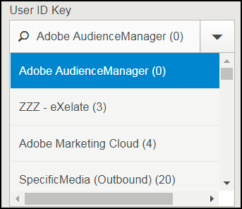
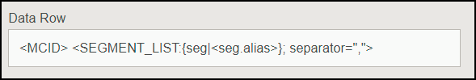

# Risoluzione dei problemi di impostazione della destinazione {#destination-setup-troubleshooting}

Informazioni su come impostare le destinazioni in Audience Manager ed evitare problemi comuni.

## Ho impostato una destinazione, ma non vedo alcun file. Dove sono? {#destination-no-files}

<!-- c_dest_tshooting.xml -->

I problemi comuni di configurazione della destinazione includono:

### Destinazione non configurata correttamente

* **Chiave [!UICONTROL UserID] non corretta:** La chiave [!UICONTROL UserID] è [!UICONTROL MasterDPID] di questa destinazione ed è la base per i valori ID che saranno in uscita. Anche se una chiave [!UICONTROL UserID] è selezionabile tramite l&#39;elenco a discesa, non significa necessariamente che ci siano ID, caratteristiche o segmenti mappati a questo valore. Se il processo [!UICONTROL Outbound] (che viene eseguito dopo la creazione delle destinazioni) non trova utenti mappati a questa chiave [!UICONTROL UserID], nessun dato verrà sottoposto a outbounded.
* **Nessuna origine dati in file selezionata:** Quando si sceglie un tipo di destinazione diverso da [!UICONTROL S2S], nella parte inferiore della schermata viene visualizzata una sezione con l&#39;etichetta [!UICONTROL Configure Data Sources]. Quando questa sezione viene visualizzata per la prima volta, non viene selezionato alcun valore. Se si dimentica di selezionare la casella di controllo [!UICONTROL All First Party] o di selezionare le origini dati singolarmente dalla finestra [!UICONTROL Available Data Sources], nessun dato risulterà in uscita.

### Formato non configurato correttamente

Quando selezioni un formato per i dati in uscita, è consigliabile, se possibile, riutilizzare un formato esistente. L’utilizzo di un formato già collaudato garantisce che i dati in uscita vengano generati correttamente. Per visualizzare esattamente la formattazione di un formato esistente, fare clic sull&#39;opzione [!UICONTROL Formats] nella barra dei menu e cercare il formato in base al nome o al numero ID. I formati non validi o le macro utilizzate nei formati forniscono un output formattato in modo errato o impediscono la trasmissione completa delle informazioni.

Per ulteriori informazioni sulla configurazione dei formati e sull&#39;utilizzo delle macro, vedere [Macro per formati file](formats/file-formats.md#) e [Macro per formati HTTP](formats/web-formats.md).

### Server non configurato correttamente

* **[!DNL FTP]**
   * **[!UICONTROL Domain]**
      * Non immettere prefissi per i nomi host. Se hai un account [!DNL ftp://hello.com], immetti semplicemente [!DNL hello.com] in questo campo.
   * **[!UICONTROL Port/Type Combination]**
      * Per un trasferimento [!DNL FTP], il tipo di trasferimento preferito è [!DNL SFTP].
      * Quando si seleziona il tipo [!DNL SFTP], la porta è quasi sempre 22.
      * Quando si seleziona il tipo [!DNL FTPs/TLS], la porta è quasi sempre 21.
      * Il tipo [!DNL FTPs/TLS] non è lo stesso di un normale trasferimento [!DNL FTP]. I trasferimenti regolari (non sicuri) di [!DNL FTP] non sono supportati.
   * **[!UICONTROL Remote Path]**
      * Quando si sceglie un percorso secondario remoto, questo deve essere immesso senza barra iniziale.
      * Se il file trasferito deve trovarsi nella sottocartella [!DNL (root)/inbound], è sufficiente aggiungere [!DNL inbound] per il percorso remoto, non [!DNL /inbound].
      * Se si inviano i file in più directory lungo il percorso, inserire delle barre tra ciascuna directory. Se ti è stata assegnata la posizione di [!DNL /inbound/subdirectory1/subdirectory2], devi immettere [!DNL inbound/subdirectory1/subdirectory2] in questo campo.
      * Se il file deve essere inserito nella directory automaticamente indirizzata al server esterno, è possibile lasciare vuoto questo spazio. Non inserire un punto ( . ), barra ( / ) o qualsiasi altra cosa.

* **[!DNL S3]**
   * [!DNL S3] è il protocollo di trasferimento preferito (su [!DNL FTP] o [!DNL HTTP]).
      * **[!UICONTROL Bucket]**
         * Il nome del bucket deve essere elencato senza barre, prefissi, suffissi e così via. Se ricevi l&#39;indirizzo [!DNL s3://your-bucket], devi semplicemente aggiungere [!DNL your-bucket] a questo campo.
      * **[!UICONTROL Directory]**
         * Lascia questo campo vuoto a meno che non ti venga specificamente assegnata una sottodirectory in cui inserire i dati. Se ti è stato assegnato l&#39;indirizzo [!DNL s3://your-bucket/your-subdirectory], immetti [!DNL your-bucket] nel campo [!UICONTROL Bucket] e [!DNL your-subdirectory] deve essere aggiunto al campo [!UICONTROL Directory]. Non aggiungere barre precedenti.
         * Se devi percorrere più directory lungo il percorso, utilizza le barre come separatori. Pertanto, una posizione di [!DNL s3://your-bucket/your-subdirectory1/your-subdirectory2] avrebbe [!DNL your-bucket] nel campo [!UICONTROL Bucket] e [!DNL your-subdirectory1/your-subdirectory2] nel campo [!UICONTROL Directory].
      * **[!UICONTROL Access / Secret Keys]**
         * Quando [!DNL TechOps] crea un bucket e fornisce le chiavi di accesso/segreto a un consulente, in genere si tratta di `READ-ONLY` credenziali che devono essere consegnate al client. Impossibile immettere le credenziali nei campi [!UICONTROL Access / Secret Key]. Il trasferimento non verrà eseguito correttamente, perché le credenziali sono di sola lettura e non sono scrivibili. Nel caso in cui [!DNL TechOps] crei un bucket e fornisca le credenziali, il consulente deve anche richiedere una coppia di chiavi Adobe - DA NON FORNIRE AL CLIENT - che consenta la scrittura di file in questo bucket. Tale chiave deve essere aggiunta in questi campi.

* **[!DNL HTTP]**
   * **[!UICONTROL Domain]**
      * Immettere le informazioni sul prefisso per [!DNL HTTP] voci. Se hai un account [!DNL https://superduper.com], immetti [!DNL https://superduper.com] in questo campo.
      * **[!UICONTROL URL Prefix]**
         * Quando aggiungi un prefisso [!DNL URL], lascia deselezionata la barra precedente. Un indirizzo di [!DNL https://hello.com/r/x/y/z] deve avere [!DNL https://hello.com] inserito nel campo [!UICONTROL Domain] e [!DNL r/x/y/z] inserito qui nel campo [!UICONTROL URL Prefix].
         * Se [!UICONTROL URL Prefix] non è necessario, lasciare vuoto questo valore.
      * **[!UICONTROL Authentication - SSH Key]**
         * Immettere il valore chiave `SSH PRIVATE` completo in questa casella, inclusi intestazioni, piè di pagina e interruzioni di riga per garantire una crittografia accurata e l&#39;archiviazione delle chiavi.

### Tempo insufficiente per la generazione in uscita

Il processo di outbounding viene eseguito due volte al giorno e più processi (outbounding, pubblicazione, push in posizioni esterne, ecc.) deve essere eseguito prima che un file venga inviato alla relativa destinazione finale. Una buona regola è che una destinazione deve essere completamente configurata almeno 24 ore prima di poter prevedere che i dati vengano inviati a una posizione esterna.

### Dimensioni di suddivisione file troppo grandi

Quando esegui l’outbounding di file nelle destinazioni, puoi suddividere file in uscita di dimensioni maggiori in blocchi di file. Assicurati che i singoli blocchi di file non superino i 10 GB. Vedi anche [Nome file dati in uscita: sintassi ed esempi](https://experienceleague.adobe.com/docs/audience-manager/user-guide/implementation-integration-guides/receiving-audience-data/batch-outbound-data-transfers/outbound-file-name-contents.html?lang=it).

## Come impostare le destinazioni per esportare ID di Experience Cloud, ID cliente o ID di Audience Manager in file di dati in uscita {#set-up-destinations-export}

In questa pagina viene illustrato come impostare le destinazioni per l&#39;esportazione dei dati con chiave del tipo ID desiderato in [!UICONTROL Outbound Data Files].

<!-- set-up-destinations-mcid-aamid.xml -->

Le destinazioni consentono ai nostri clienti di attivare i propri dati su qualsiasi numero di canali digitali. Ad esempio, possono esportare i dati del pubblico in altre soluzioni [!DNL Adobe Experience Cloud] ([!DNL Target], [!DNL Campaign], ecc.). Oppure, possono inviare dati a [!UICONTROL DSP], [!UICONTROL SSP] o a qualsiasi piattaforma integrata con Audience Manager. Nella nostra [pagina Wiki Integrazioni](https://wiki.corp.adobe.com/display/MCPI) abbiamo un elenco di partner con cui lavoriamo.

>[!NOTE]
>
>Per una procedura dettagliata sulla creazione di destinazioni nell&#39;interfaccia utente di amministrazione, consulta l&#39;articolo [Creare o modificare le destinazioni aziendali](companies/admin-manage-company-destinations.md#create-edit-company-destinations).

I clienti vogliono esportare diversi tipi di ID, a seconda della destinazione. Il grafico di configurazione seguente mostra le opzioni da selezionare per esportare le informazioni di profilo relative a diversi tipi di ID. È inoltre consigliabile fare riferimento all&#39;[Indice degli ID in Audience Manager](https://experienceleague.adobe.com/docs/audience-manager/user-guide/reference/ids-in-aam.html?lang=it). Sono disponibili tre impostazioni importanti da considerare: [!UICONTROL User ID Key], [!UICONTROL Data Source Type] e [!UICONTROL Format]. Di seguito vengono fornite informazioni dettagliate su tutti i dettagli.

* [!UICONTROL User ID Key]. In [!UICONTROL Admin UI], vai a **[!UICONTROL Companies]**. Cerca l’azienda del cliente e fai clic su di essa. Cercare la scheda **[!UICONTROL Destinations]** e premere **[!UICONTROL Add Destination]**. Nel flusso di lavoro **[!UICONTROL Add Destination]**, selezionare [!UICONTROL User ID Key]. [!UICONTROL User ID Key] filtrerà gli ID in ingresso dall&#39;origine dati di destinazione e consentirà solo il passaggio degli ID.

  

* [!UICONTROL Data Source Type]. Seleziona questa opzione durante la creazione di una destinazione nell’interfaccia utente di Audience Manager. Innanzitutto, seleziona [!UICONTROL Inbound], quindi seleziona il tipo di ID desiderato. Le opzioni sono:

  

* [!UICONTROL Format]. Questa opzione determina il formato del file da esportare. Nel flusso di lavoro **[!UICONTROL Add Destination]** selezionare il formato in **[!UICONTROL Batch Data]**.

Per esaminare un formato, passare a **[!UICONTROL Admin UI > Formats]** e cercare l&#39;elemento [!UICONTROL Data Row]. Questo elemento contiene una macro del formato file, &lt;MCID> nell’esempio seguente.

<table id="table_DAEE5BC75DCB4FC690C4BAE41F627DEC"> 
 <thead> 
  <tr> 
   <th colname="col01" class="entry"> Nr. configurazione </th> 
   <th colname="col1" class="entry"> 
Chiave utente 
 </th> 
   <th colname="col2" class="entry"> 
Tipo di Source dati 
 </th> 
   <th colname="col3" class="entry"> 
Formato 
 </th> 
   <th colname="col4" class="entry"> 
Tipo ID esportato 
 </th> 
  </tr>
 </thead>
 <tbody> 
  <tr> 
   <td colname="col01"> 1 </td> 
   <td colname="col1"> 
Adobe Audience Manager (0) 
 </td> 
   <td colname="col2"> 
Experience Cloud ID 
 </td> 
   <td colname="col3"> 
&lt;DP_UUID&gt; 
 </td> 
   <td colname="col4"> 
Experience Cloud ID 
 </td> 
  </tr> 
  <tr> 
   <td colname="col01"> 2 </td> 
   <td colname="col1"> 
Adobe Audience Manager (0) 
 </td> 
   <td colname="col2"> 
Experience Cloud ID 
 </td> 
   <td colname="col3"> 
MCID 
 </td> 
   <td colname="col4"> 
UUID di Audience Manager 
 </td> 
  </tr> 
  <tr> 
   <td colname="col01"> 3 </td> 
   <td colname="col1"> 
Adobe Audience Manager (0) 
 </td> 
   <td colname="col2"> 
Experience Cloud ID 
 </td> 
   <td colname="col3"> 
UUID 
 </td> 
   <td colname="col4"> 
Experience Cloud ID 
 </td> 
  </tr> 
  <tr> 
   <td colname="col01"> 4 </td> 
   <td colname="col1"> 
Adobe Audience Manager (0) 
 </td> 
   <td colname="col2"> 
ID AUDIENCE MANAGER 
 </td> 
   <td colname="col3"> 
&lt;DP_UUID&gt; 
 </td> 
   <td colname="col4"> 
UUID di Audience Manager 
 </td> 
  </tr> 
  <tr> 
   <td colname="col01"> 5 </td> 
   <td colname="col1"> 
Adobe Audience Manager (0) 
 </td> 
   <td colname="col2"> 
ID AUDIENCE MANAGER 
 </td> 
   <td colname="col3"> 
MCID 
 </td> 
   <td colname="col4"> 
Experience Cloud ID 
 </td> 
  </tr> 
  <tr> 
   <td colname="col01"> 6 </td> 
   <td colname="col1"> 
Adobe Audience Manager (0) 
 </td> 
   <td colname="col2"> 
ID AUDIENCE MANAGER 
 </td> 
   <td colname="col3"> 
UUID 
 </td> 
   <td colname="col4"> 
UUID di Audience Manager 
 </td> 
  </tr> 
  <tr> 
   <td colname="col01"> 7 </td> 
   <td colname="col1"> 
DPID (qualsiasi origine dati a cui l’azienda ha accesso) 
 </td> 
   <td colname="col2"> 
ID cliente 
 </td> 
   <td colname="col3"> 
&lt;DP_UUID&gt; 
 </td> 
   <td colname="col4"> 
ID cliente (DPUUID) 
 </td> 
  </tr> 
  <tr> 
   <td colname="col01"> 8 </td> 
   <td colname="col1"> 
DPID (qualsiasi origine dati a cui l’azienda ha accesso) 
 </td> 
   <td colname="col2"> 
ID cliente 
 </td> 
   <td colname="col3"> 
MCID 
 </td> 
   <td colname="col4"> 
Experience Cloud ID 
 </td> 
  </tr> 
  <tr> 
   <td colname="col01"> 9 </td> 
   <td colname="col1"> 
DPID (qualsiasi origine dati a cui l’azienda ha accesso) 
 </td> 
   <td colname="col2"> 
ID cliente 
 </td> 
   <td colname="col3"> 
UUID 
 </td> 
   <td colname="col4"> 
UUID di Audience Manager 
 </td> 
  </tr> 
  <tr> 
   <td colname="col01"> 10 </td> 
   <td colname="col1"> 
DPID (qualsiasi origine dati a cui l’azienda ha accesso) 
 </td> 
   <td colname="col2"> 
ID AUDIENCE MANAGER 
 </td> 
   <td colname="col3"> 
&lt;DP_UUID&gt; 
 </td> 
   <td colname="col4"> 
UUID di Audience Manager 
 </td> 
  </tr> 
  <tr> 
   <td colname="col01"> 11 </td> 
   <td colname="col1"> 
DPID (qualsiasi origine dati a cui l’azienda ha accesso) 
 </td> 
   <td colname="col2"> 
ID AUDIENCE MANAGER 
 </td> 
   <td colname="col3"> 
MCID 
 </td> 
   <td colname="col4"> 
Experience Cloud ID 
 </td> 
  </tr> 
  <tr> 
   <td colname="col01"> 12 </td> 
   <td colname="col1"> 
DPID (qualsiasi origine dati a cui l’azienda ha accesso) 
 </td> 
   <td colname="col2"> 
ID AUDIENCE MANAGER 
 </td> 
   <td colname="col3"> 
UUID 
 </td> 
   <td colname="col4"> 
UUID di Audience Manager 
 </td> 
  </tr> 
 </tbody> 
</table>

## Casi d&#39;uso

Si supponga di utilizzare Audience Manager e [!DNL Campaign]. Per rendere fruibili i dati del cliente in [!DNL Campaign], esportare [!UICONTROL Experience Cloud IDs]. In questo caso, utilizza il numero di configurazione 3.
