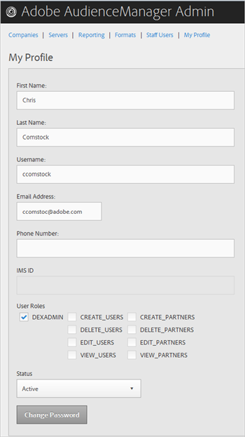

# Il mio profilo {#my-profile}

Modifica i dettagli del tuo profilo Audience Manager Admin Tool o modifica la password.

<!-- c_my_profile.xml -->

## Modifica profilo {#edit-profile}

Visualizza e modifica il profilo dello strumento di amministrazione di Audience Manager, inclusi nome e cognome, nome utente, indirizzo e-mail, numero di telefono, [!UICONTROL IMS ID], ruoli utente e stato.

<!-- t_edit_profile.xml -->

1. Fare clic su **[!UICONTROL My Profile]**.

   

2. Compila i campi:
   * **[!UICONTROL First Name]:** (obbligatorio) Specificare il nome.
   * **[!UICONTROL Last Name]:** (obbligatorio) Specificare il cognome.
   * **[!UICONTROL Username]:** (obbligatorio) Specificare il nome utente.
   * **[!UICONTROL Email Address]:** (obbligatorio) Specifica il tuo indirizzo e-mail.
   * **[!UICONTROL Phone Number]:** Specificare il numero di telefono.
   * **[!UICONTROL IMS ID]:** Specificare l&#39;ID del servizio di messaggistica Internet.
   * **[!UICONTROL User Roles]:** Selezionare i ruoli utente desiderati:
      * **[!UICONTROL DEXADMIN]:** Fornisce l&#39;accesso di amministratore per eseguire attività nello strumento di amministrazione Audience Manager. Se non si seleziona questa opzione, è possibile scegliere singoli ruoli. Questi ruoli consentono agli utenti di eseguire attività utilizzando [!DNL API] chiamate, ma non nello strumento di amministrazione.
      * **[!UICONTROL CREATE_USERS]:** consente agli utenti di creare nuovi utenti utilizzando una chiamata [!DNL API].
      * **[!UICONTROL DELETE_USERS]:** consente agli utenti di eliminare gli utenti esistenti utilizzando una chiamata [!DNL API].
      * **[!UICONTROL EDIT_USERS]:** consente agli utenti di modificare gli utenti esistenti utilizzando una chiamata [!DNL API].
      * **[!UICONTROL VIEW_USERS]:** consente agli utenti di visualizzare altri utenti nella configurazione dell&#39;Audience Manager utilizzando una chiamata [!DNL API].
      * **[!UICONTROL CREATE_PARTNERS]:** consente agli utenti di creare partner Audienci Manager utilizzando una chiamata [!DNL API].
      * **[!UICONTROL DELETE_PARTNERS]:** consente agli utenti di eliminare i partner Audienci Manager utilizzando una chiamata [!DNL API].
      * **[!UICONTROL EDIT_PARTNERS]:** consente agli utenti di modificare i partner Audienci Manager utilizzando una chiamata [!DNL API].
      * **[!UICONTROL VIEW_PARNTERS]:** consente agli utenti di visualizzare i partner Audienci Manager utilizzando una chiamata [!DNL API].
   * **[!UICONTROL Status]:** Selezionare lo stato desiderato:
      * **[!UICONTROL Active]:** Specifica che l&#39;utente è un utente Audience Manager attivo.
      * **[!UICONTROL Deactivated]:** Specifica che l&#39;utente è un utente disattivato in Gestione dell&#39;audience.
      * **[!UICONTROL Expired]:** Specifica che l&#39;account dell&#39;utente nell&#39;Audience Manager è scaduto.
      * **[!UICONTROL Locked Out]:** Specifica che l&#39;account dell&#39;utente nell&#39;Audience Manager è bloccato.
3. Fare clic su **[!UICONTROL Submit]**.

## Cambia password {#change-password}

Cambia la password dello strumento di amministrazione Audience Manager.

<!-- t_change_password.xml -->

1. Fare clic su **[!UICONTROL My Profile]**.
1. Fare clic su **[!UICONTROL Change Password]**.

   

   La password di Audience Manager deve essere:

   * Lunghezza minima di otto caratteri;
   * contenere almeno un carattere maiuscolo;
   * contenere almeno un carattere minuscolo;
   * contenere almeno un numero;
   * contenere almeno un carattere speciale;
   * Iniziare e terminare con un carattere alfanumerico;
   * Iniziare e terminare con un carattere alfanumerico.

1. Specifica la vecchia password.
1. Specifica la nuova password, quindi conferma la nuova password.
1. Fare clic su **[!UICONTROL OK]**.
