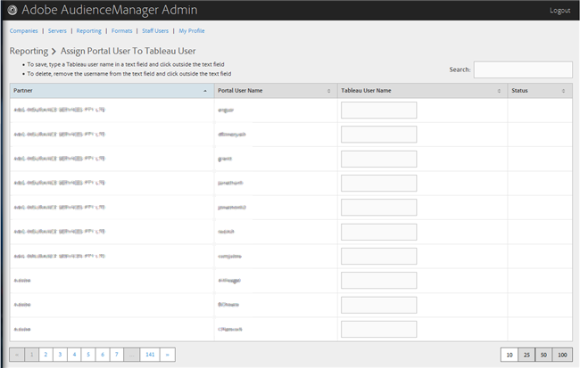

# Assegnare un utente del portale a un utente Tableau {#assign-a-portal-user-to-tableau-user}

<!-- t_tabeau.xml -->

Utilizzare la pagina [!UICONTROL Reporting] per impostare un utente del portale come utente [!DNL Tableau]. Questo consente agli utenti di visualizzare [!DNL Tableau] report in Audience Manager.

1. Fare clic su **[!UICONTROL Reporting]** > **[!UICONTROL Assign Portal User to Tableau User]**.

   

1. Per assegnare un utente, nella riga partner desiderata, digitare un nome utente [!DNL Tableau] nel campo di testo, quindi fare clic all&#39;esterno del campo di testo.

Per eliminare un&#39;assegnazione utente, nella riga partner desiderata rimuovere il nome utente dal campo di testo, quindi fare clic all&#39;esterno del campo di testo.
