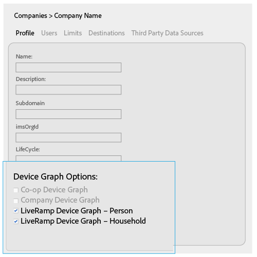
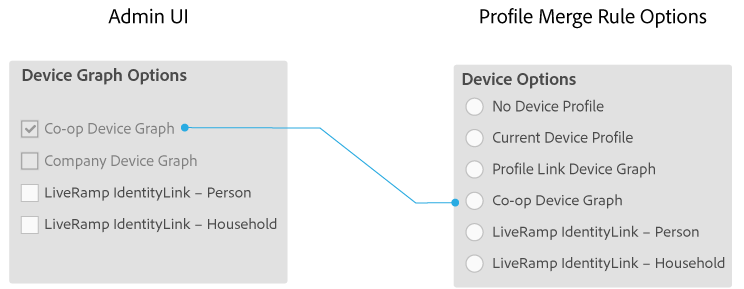

# Opzioni di Device Graph per le società {#device-graph-options-for-companies}

I [!UICONTROL Device Graph Options] sono disponibili per le aziende che partecipano a [!DNL Adobe Experience Cloud Device Co-op]. Se un cliente ha anche una relazione contrattuale con un provider di grafici dei dispositivi di terze parti integrato con Audience Manager, questa sezione mostrerà le opzioni per tale grafico dei dispositivi. Queste opzioni si trovano in [!UICONTROL Companies] > nome società > [!UICONTROL Profile] > [!UICONTROL Device Graph Options].

Questa illustrazione utilizza nomi generici per le opzioni del grafico dei dispositivi di terze parti. In produzione, questi nomi provengono dal provider del grafico dei dispositivi e possono variare rispetto a quanto mostrato qui. Ad esempio, le opzioni [!DNL LiveRamp] in genere (ma non sempre):

* Inizia con &quot;[!DNL LiveRamp]&quot;
* Contengono un secondo nome che varia
* Termina con &quot;[!UICONTROL - Household]&quot; o &quot;[!UICONTROL -Person]&quot;

## Opzioni di Device Graph definite {#device-graph-options-defined}

Le opzioni del grafico dei dispositivi selezionate qui espongono o nascondono le scelte di [!UICONTROL Device Options] disponibili per un cliente [!DNL Audience Manager] quando crea un [!UICONTROL Profile Merge Rule].

### Grafico dei dispositivi Co-op {#co-op-graph}

I clienti che partecipano a [Adobe Experience Cloud Device Co-op](https://experienceleague.adobe.com/docs/device-co-op/using/about/overview.html?lang=en) utilizzano queste opzioni per creare un [!UICONTROL Profile Merge Rule] con [dati deterministici e probabilistici](https://experienceleague.adobe.com/docs/device-co-op/using/device-graph/links.html?lang=en). [!DNL Corporate Provisioning Team] attiva e disattiva questa opzione tramite una chiamata back-end [!DNL API]. Impossibile selezionare o deselezionare queste caselle in [!DNL Admin UI]. Le opzioni **[!UICONTROL Co-op Device Graph]** e **[!UICONTROL Company Device Graph]** si escludono a vicenda. I clienti possono chiederci di attivare uno o l’altro, ma non entrambi. Se questa opzione è selezionata, il controllo **[!UICONTROL Co-op Device Graph]** viene esposto nelle impostazioni [!UICONTROL Device Options] per un oggetto [!UICONTROL Profile Merge Rule].

### Grafico dei dispositivi della società {#company-graph}

Questa opzione è per i clienti [!DNL Analytics] che utilizzano la metrica [!UICONTROL People] nella suite di rapporti [!DNL Analytics]. [!DNL Corporate Provisioning Team] attiva e disattiva questa opzione tramite una chiamata back-end [!DNL API]. Impossibile selezionare o deselezionare queste caselle in [!DNL Admin UI]. Le opzioni **[!UICONTROL Company Device Graph]** e **[!UICONTROL Co-op Device Graph]** si escludono a vicenda. I clienti possono chiederci di attivare uno o l’altro, ma non entrambi. Se questa opzione è selezionata:

* Questo grafico dei dispositivi utilizza dati deterministici che appartengono all’azienda che stai configurando (nessun dato probabilistico).
* [!DNL Audience Manager] crea automaticamente un [!UICONTROL Data Source] denominato `*`nome partner`*-Company Device Graph-Person`. Nella pagina dei dettagli [!UICONTROL Data Source], i clienti [!DNL Audience Manager] possono modificare il nome del partner, la descrizione e applicare [Controlli sull&#39;esportazione dei dati](https://experienceleague.adobe.com/docs/device-co-op/using/device-graph/links.html?lang=en) a questa origine dati.
* [!DNL Audience Manager] clienti *non* visualizzano una nuova impostazione nella sezione [!UICONTROL Device Options] per [!UICONTROL Profile Merge Rule].

### Grafico dei dispositivi LiveRamp (persona o famiglia) {#liveramp-device-graph}

Queste caselle di controllo sono abilitate in [!DNL Admin UI] quando un partner crea un [!UICONTROL Data Source] e seleziona **[!UICONTROL Use as an Authenticated Profile]** e/o **[!UICONTROL Use as a Device Graph]**. I nomi di queste impostazioni sono determinati dal provider del grafico dei dispositivi di terze parti (ad esempio [!DNL LiveRamp], [!DNL TapAd] e così via). Se questa opzione è selezionata, significa che l’azienda che stai configurando utilizzerà i dati forniti da questi grafici dei dispositivi.

>[!MORELIKETHIS]
>
>* [Definizione delle opzioni delle regole di unione profili](https://experienceleague.adobe.com/docs/audience-manager/user-guide/features/profile-merge-rules/merge-rule-definitions.html?lang=en).
>* [Impostazioni e opzioni di menu di Data Source](https://experienceleague.adobe.com/docs/audience-manager/user-guide/features/data-sources/datasources-list-and-settings.html?lang=en)
