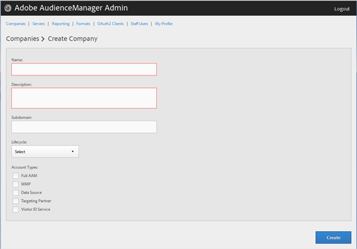

# Creare un profilo aziendale {#create-a-company-profile}

Utilizzare la pagina [!UICONTROL Companies] nello strumento di amministrazione Audience Manager per creare una nuova società.

<!-- t_create_company.xml -->

>[!NOTE]
>
>Per creare nuove società è necessario avere il ruolo **[!UICONTROL DEXADMIN]**.

1. Fare clic su **[!UICONTROL Companies]** > **[!UICONTROL Add Company]**.
1. Compila i campi:

   * **[!UICONTROL Name]**: (obbligatorio) specificare il nome della società.
   * **[!UICONTROL Description]**: (obbligatorio) fornire informazioni descrittive sull&#39;azienda, ad esempio il settore o il nome completo.
   * **[!UICONTROL Subdomain]**: (obbligatorio) specificare il sottodominio della società. Il testo immesso è il sottodominio della chiamata dell’evento. Questo non può essere modificato. Deve essere una stringa di [!DNL URL] caratteri validi.

     Ad esempio, se la società si chiama [!DNL AcmeCorp], il sottodominio sarà [!DNL acmecorp].

     Audience Manager utilizza il sottodominio per [!UICONTROL Data Collection Server] (DCS). Nell&#39;esempio precedente, se [!DNL URL] completo della tua società in [!UICONTROL DCS] sarebbe [!DNL acmecorp.demdex.net].

   * **[!UICONTROL Lifecyle]**: specificare la fase desiderata per la società:
      * **[!UICONTROL Active]**: specificare che la società sarà un client Audience Manager attivo. Per account [!UICONTROL Active] si intende un cliente pagante, non solo per consulenza, ma per l&#39;Audience Manager SKU.
      * **[!UICONTROL Demo]**: specificare che la società verrà utilizzata solo a scopo dimostrativo. I dati di reporting verranno contraffatti automaticamente.
      * **[!UICONTROL Prospect]**: specificare che la società è un potenziale cliente Audience Manager, ad esempio una società a cui viene assegnato gratuitamente [!DNL POC] o una configurazione account per una demo vendite.
      * **[!UICONTROL Test]**: specificare che la società verrà utilizzata solo per test interni.

   * **[!UICONTROL Account Types]**: specificare il set completo di tipi di account per questa società. Nessun tipo di account si esclude a vicenda con altri tipi.
      * **[!UICONTROL Full AAM]**: specificare che la società avrà un account Adobe Audience Manager completo e che gli utenti avranno accesso.
      * **[!UICONTROL MMP]**: specificare che la società è stata abilitata per l&#39;utilizzo delle funzionalità di [!UICONTROL Master Marketing Profile] ([!UICONTROL MMP]). [!UICONTROL MMP] consente la condivisione dei tipi di pubblico in tutto l&#39;Experience Cloud utilizzando un [!UICONTROL Experience Cloud ID] ([!DNL MCID]) assegnato a ogni visitatore e quindi utilizzato dall&#39;Audience Manager. Se si seleziona questo tipo di account, viene selezionato automaticamente anche [!UICONTROL Experience Cloud ID Service].

        Per ulteriori informazioni, consulta [Tipi di pubblico Experience Cloud](https://experienceleague.adobe.com/docs/core-services/interface/services/audiences/audience-library.html?lang=en).

   * **[!UICONTROL Data Source]**: specificare che la società è un provider di dati di terze parti in Audience Manager.
   * **[!UICONTROL Targeting Partner]**: specificare che la società funge da piattaforma di targeting, ad Audience Manager per i clienti.
   * **[!UICONTROL Visitor ID Service]**: specificare che la società è stata abilitata a utilizzare [!UICONTROL Experience Cloud Visitor ID Service].

     [!UICONTROL Experience Cloud Visitor ID Service] fornisce un ID visitatore universale in tutte le soluzioni Experience Cloud. Per ulteriori informazioni, consulta la [guida utente del servizio ID visitatore di Experience Cloud](https://experienceleague.adobe.com/docs/id-service/using/intro/overview.html?lang=en).

   * **[!UICONTROL Agency]**: specificare che la società avrà un account [!UICONTROL Agency].

1. Fare clic su **[!UICONTROL Create]**. Continuare con le istruzioni in [Modifica un profilo aziendale](../companies/admin-manage-company-profiles.md#edit-company-profile).

   

## Modificare un profilo società {#edit-company-profile}

Modifica il profilo di un’azienda, compresi nome, descrizione, sottodominio, ciclo di vita e altro ancora.

<!-- t_edit_company_profile.xml -->

1. Fai clic su **[!UICONTROL Companies]**, quindi individua e fai clic sulla società desiderata per visualizzarne la pagina [!UICONTROL Profile].

   Utilizzare la casella [!UICONTROL Search] o i controlli di impaginazione nella parte inferiore dell&#39;elenco per trovare la società desiderata. Puoi ordinare ogni colonna in ordine crescente o decrescente facendo clic sull’intestazione della colonna desiderata.

   

1. Modifica i campi come necessario:

   * **[!UICONTROL Name]**: modificare il nome della società. Questo campo è obbligatorio.
   * **[!UICONTROL Description]**: modificare la descrizione della società. Questo campo è obbligatorio.
   * **[!UICONTROL Subdomain]**: (obbligatorio) specificare il sottodominio della società. Il testo immesso è il sottodominio della chiamata dell’evento. Questo non può essere modificato. Deve essere una stringa di [!DNL URL] caratteri validi.

     Ad esempio, se la società si chiama [!DNL AcmeCorp], il sottodominio sarà [!DNL acmecorp].

     Audience Manager utilizza il sottodominio per [!UICONTROL Data Collection Server] (DCS). Nell&#39;esempio precedente, se [!DNL URL] completo della tua società in [!UICONTROL DCS] sarebbe [!DNL acmecorp.demdex.net].

   * **[!UICONTROL imsOrgld]**: ([!UICONTROL Identity Management System Organization ID]) Questo ID consente di connettere la società con Adobe Experience Cloud.
   * **[!UICONTROL Lifecyle]**: specificare la fase desiderata per la società:
      * **[!UICONTROL Active]**: specificare che la società sarà un client Audience Manager attivo. Per account attivo si intende un cliente pagante, non solo per consulenza, ma per SKU di Audience Manager.
      * **[!UICONTROL Demo]**: specificare che la società verrà utilizzata solo a scopo dimostrativo. I dati di reporting verranno contraffatti automaticamente.
      * **[!UICONTROL Prospect]**: specificare che la società è un potenziale cliente Audience Manager, ad esempio una società a cui viene assegnato gratuitamente [!DNL POC] o una configurazione account per una demo vendite.
      * **[!UICONTROL Test]**: specificare che la società verrà utilizzata solo per test interni.
   * **[!UICONTROL Account Types]**: specificare il set completo di tipi di account per questa società. Nessun tipo di account si esclude a vicenda con altri tipi.
      * **[!UICONTROL Full AAM]**: specificare che la società avrà un account Adobe Audience Manager completo e che gli utenti avranno accesso.
      * **[!UICONTROL MMP]**: specificare che la società è stata abilitata per l&#39;utilizzo delle funzionalità del profilo marketing principale ([!UICONTROL MMP]).

        Se si seleziona questo tipo di account, viene selezionato automaticamente anche **[!UICONTROL Visitor ID Service]**.
Per ulteriori informazioni, consulta [Tipi di pubblico Experience Cloud](https://experienceleague.adobe.com/docs/core-services/interface/services/audiences/audience-library.html?lang=en).

   * **[!UICONTROL Data Source]**: specificare che la società è un provider di dati di terze parti in Audience Manager.
   * **[!UICONTROL Targeting Partner]**: specificare che la società funge da piattaforma di targeting, ad Audience Manager per i clienti.
   * **[!UICONTROL Visitor ID Service]**: specificare che la società è stata abilitata per l&#39;utilizzo del servizio ID visitatore di Experience Cloud.

     Il servizio ID visitatore di Experience Cloud fornisce un ID visitatore universale per tutte le soluzioni Experience Cloud. Per ulteriori informazioni, consulta la [guida utente del servizio ID Experience Cloud](https://experienceleague.adobe.com/docs/id-service/using/home.html?lang=en).

   * **[!UICONTROL Agency]**: specificare che la società avrà un account Agenzia.
   * **[!UICONTROL Features]**: selezionare le opzioni desiderate:
      * **[!UICONTROL Password Expiration]**: imposta la scadenza di tutte le password utente di questa società dopo 90 giorni per aumentare la sicurezza di Audience Manager.
      * **[!UICONTROL Reporting]**: abilita la generazione di rapporti Audience Manager per questa società.
      * **[!UICONTROL Role Based Access Controls]**: abilitare i controlli di accesso basati su ruolo per questa società. I controlli dell’accesso basati sul ruolo consentono di creare gruppi di utenti con autorizzazioni di accesso diverse. I singoli utenti all’interno di questi gruppi possono quindi accedere solo a funzioni specifiche di Audience Manager.

1. Fare clic su **[!UICONTROL Submit Updates]**.

## Eliminare un profilo società {#delete-company-profile}

Utilizzare la pagina [!UICONTROL Companies] nello strumento Audience Manager [!UICONTROL Admin] per eliminare una società esistente.

<!-- t_delete_company.xml -->

>[!NOTE]
>
>È necessario avere il ruolo [!UICONTROL DEXADMIN] per eliminare le società esistenti.

1. Per eliminare una società esistente, fare clic su **[!UICONTROL Companies]**.

   

1. Fare clic su  nella colonna **[!UICONTROL Actions]** della società desiderata.
1. Fare clic su **[!UICONTROL OK]** per confermare l&#39;eliminazione.
