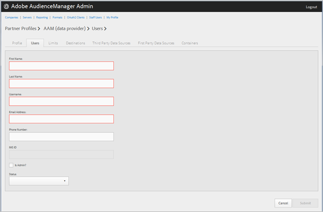

# Gestire gli utenti aziendali {#manage-company-users}

Creazione di nuovi utenti Audience Manager o modifica ed eliminazione di utenti esistenti.

<!-- t_manage_company_users.xml -->

1. Fai clic su **[!UICONTROL Companies]**, quindi individua e fai clic sulla società desiderata per visualizzarne la pagina [!UICONTROL Profile].

   Utilizzare la casella [!UICONTROL Search] o i controlli di impaginazione nella parte inferiore dell&#39;elenco per trovare la società desiderata. Puoi ordinare ogni colonna in ordine crescente o decrescente facendo clic sull’intestazione della colonna desiderata.
1. Fare clic sulla scheda **[!UICONTROL Users]**.
1. Per creare un nuovo utente, scegliere **[!UICONTROL Create a New User]**. Per modificare un utente esistente, individuare e fare clic sull&#39;utente desiderato nella colonna **[!UICONTROL Username]**.

   

1. Compila i campi:

   * **[!UICONTROL First Name]**: (obbligatorio) specificare il nome dell&#39;utente.
   * **[!UICONTROL Last Name]**: (obbligatorio) specificare il cognome dell&#39;utente.
   * **[!UICONTROL Username]**: (obbligatorio) specifica il nome utente Audience Manager dell&#39;utente. I nomi utente devono essere univoci.
   * **[!UICONTROL Email Address]**: (obbligatorio) specificare l&#39;indirizzo e-mail dell&#39;utente.
   * **[!UICONTROL Phone Number]**: specificare il numero di telefono dell&#39;utente.
   * **[!UICONTROL IMS ID]**: [!UICONTROL Identity Management System ID] dell&#39;utente. Questo ID consente all’utente di collegarsi a Adobi di soluzioni per Adobe Experience Cloud.
   * **[!UICONTROL Is Admin]**: rendere questo utente un Audience Manager utente amministrativo. Un amministratore dispone di tutti i ruoli utente Audienci Manager per questo partner.
   * **[!UICONTROL Status]**: durante la creazione di un nuovo utente, questo campo viene inizialmente visualizzato come **[!UICONTROL Pending]** finché l&#39;utente non effettua l&#39;accesso e reimposta la password temporanea. Se stai modificando un utente esistente, puoi scegliere tra i seguenti stati:
      * **[!UICONTROL Active]**: specifica che questo utente è un utente Audience Manager attivo.
      * **[!UICONTROL Deactivated]**: specifica che l&#39;utente è un utente Audience Manager disattivato.
      * **[!UICONTROL Expired]**: specifica che l&#39;utente è scaduto.
      * **[!UICONTROL Locked Out]**: specifica che l&#39;utente è un utente bloccato.

1. Fare clic su **[!UICONTROL Submit]**.

## Eliminare un utente {#delete-user}

Per eliminare un utente:

1. Fare clic su **[!UICONTROL Companies]**, individuare e selezionare la società desiderata, quindi fare clic sulla scheda **[!UICONTROL Users]**.
1. Fare clic su  nella colonna **[!UICONTROL Actions]** dell&#39;utente desiderato.
1. Fare clic su **[!UICONTROL OK]** per confermare l&#39;eliminazione.
