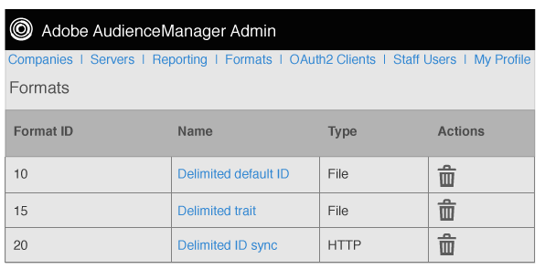

# Panoramica dei formati {#formats-overview}

Un formato è un modello (o file) salvato che utilizza macro per organizzare il contenuto dei dati inviati a una destinazione. I tipi di formato includono [!DNL HTTP] formati e formati di file. I formati [!DNL HTTP] inviano dati in un oggetto [!DNL JSON] con un metodo [!DNL POST] o [!DNL GET]. I formati di file inviano i dati in un file da [!DNL FTP]. Le macro utilizzate da ciascun formato consentono di impostare i nomi dei file, definire le intestazioni dei file e organizzare il contenuto di un file di dati. In Admin [!DNL UI] è possibile creare, salvare e riutilizzare i formati durante la configurazione delle destinazioni per i clienti.

